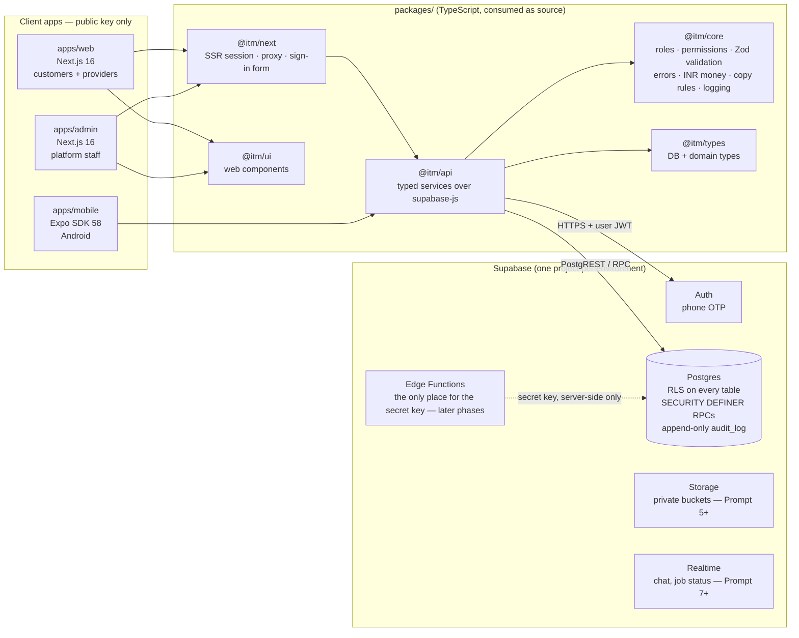

# Architecture

**Status:** Phase 2 (Prompt 3) foundation — 2026-11-22

## Overview



## Request path and where each rule is enforced

```mermaid
sequenceDiagram
  participant U as User (browser / Android)
  participant P as Next.js proxy.ts
  participant S as Server Component / Server Action
  participant A as @itm/api service
  participant DB as Postgres (RLS + RPC)

  U->>P: request with session cookie
  P->>P: refresh session; redirect to /sign-in if protected and signed out
  P->>S: render
  S->>S: getSession() → roles (UI decides what to show)
  S->>A: e.g. registerRole('customer')
  A->>A: Zod validation (same schema as the client form)
  A->>DB: rpc('register_role') as the user's JWT
  DB->>DB: require_active_user(), role checks, constraints, audit
  DB-->>A: ok / SQLSTATE error
  A-->>S: data or AppError (safe user message)
```

**Order of trust.** Each layer may refuse; only the database decides.

| Layer | Purpose | Can be bypassed by a hostile client? |
|---|---|---|
| UI (`can()` in `@itm/core`) | Hide actions the user can't take | Yes — convenience only |
| Proxy (`proxy.ts`) | Redirect signed-out users | Yes — convenience only |
| Server code / services | Validate input (Zod), friendly errors | Yes (a client can call Supabase directly) |
| **Postgres** (RLS, column grants, RPC checks, constraints, triggers) | **Access control and business rules** | **No** |

## Roles

| Role | Scope | Granted by |
|---|---|---|
| `customer` | user | Self (`register_role`) |
| `technician` | user | Self (`register_role`) |
| `company_admin` | organization | `create_organization` (creator) |
| `company_technician` | organization | Company admin (invite flow — Prompt 5) |
| `support_agent` | platform | Platform admin (`grant_staff_role`) |
| `platform_admin` | platform | Platform admin; the first one is bootstrapped with SQL ([setup.md](setup.md)) |

A user can hold several roles; they are rows in `user_roles` and are revoked by setting `revoked_at`, so history is kept. The permission matrix in `packages/core/src/roles.ts` mirrors the database. No role other than `customer` can approve an estimate or a part cost, including admins.

## Data model so far (`supabase/migrations/20261122000100_foundation.sql`)

| Table | Purpose | Who can read | Who can write |
|---|---|---|---|
| `profiles` | One per auth user | self, staff | self (name/email/language); platform admin (status). Never deleted through the API. |
| `organizations` | Service companies | members, staff | `create_organization`; company admin renames |
| `user_roles` | Role grants | self, own company admin, staff | RPCs only |
| `legal_documents` | Versioned terms with review status | everyone (non-withdrawn) | operator / platform admin (SQL for now) |
| `terms_acceptances` | Who accepted which version, and its review status at the time | self, staff | `accept_legal_document` |
| `audit_log` | Append-only trail | platform admin | Triggers and RPCs only. No update, delete or truncate for anyone, including the database owner. |

## Rendering

Next.js 16 scaffolds with Cache Components on. It is **off** in both web apps: every page here depends on the signed-in user, and per-request rendering is simpler to reason about for access control. Per-user pages also set `export const dynamic = "force-dynamic"`.

## Error handling and logging

- All data-layer failures become an `AppError` with a stable `code` and a safe `userMessage` (`packages/core/src/errors.ts`). Raw database text never reaches the UI.
- SQL business rules raise `'ITM:<rule>: <message>'`; the message after the rule code is shown to the user.
- `reportError()` sends unexpected errors to a pluggable sink: the console today, Sentry once a DSN exists. Expected outcomes (validation, forbidden) are not reported. `redact()` strips phone numbers.

## Testing

| Suite | Tool | What it proves |
|---|---|---|
| `packages/core/test` | Vitest | Permissions matrix, validation, INR money, error mapping, copy rules |
| `packages/api/test` | Vitest | Services validate before calling Supabase; key guard rejects secret keys |
| `supabase/tests` | Vitest + **PGlite** (Postgres in WebAssembly) with a Supabase shim | Migrations apply; RLS isolation (customer A/B, company A/B); RPC rules; audit append-only; schema guardrails |
| `scripts/guards` | Vitest | Banned wording, no secret keys in client code, no payment SDKs, legal drafts marked |

PGlite lets RLS tests run without Docker. It reproduces `auth.uid()` and Supabase's grants, but it is not Supabase. Before each release, run the same scenarios against the hosted dev project (see [setup.md](setup.md)).

## Decisions and deferred items

| Decision | Reason |
|---|---|
| npm workspaces, packages consumed as TypeScript source (no build step) | Simplest set-up; Next `transpilePackages` and Metro handle TS |
| No service-role client anywhere yet | Nothing in Phase 2 needs it. Later privileged work goes into Supabase Edge Functions. |
| Hand-written `@itm/types/database.ts` | No linked project yet; replace with `npm run db:types` once linked |
| Mobile session in SecureStore (chunked) | Tokens stay in the Android Keystore-backed store, not plain AsyncStorage |
| Sentry not installed | Needs a DSN and a DPDP processor review first; sink seam is ready |
